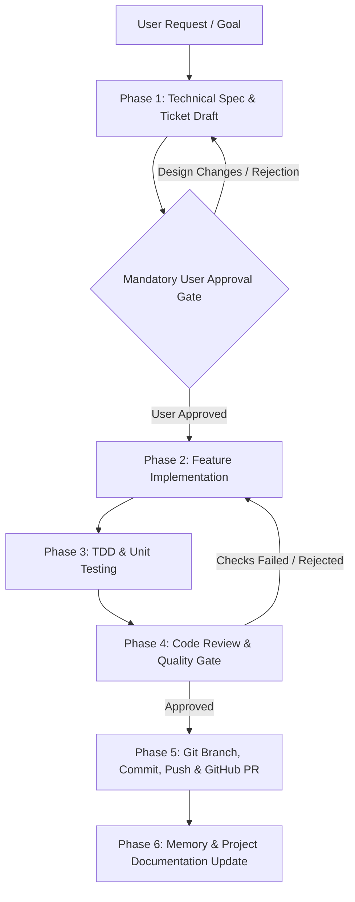

# 🚀 Feature Development Pipeline Skill

[](LICENSE)
[](https://github.com/FrancoRodriguez/feature-development-pipeline-skill)
[](https://github.com/FrancoRodriguez/feature-development-pipeline-skill/pulls)

A structured, 6-phase autonomous software engineering pipeline designed for agentic AI coding assistants (Google Antigravity, Cursor, Claude Code, Windsurf, AGY CLI).

This skill enforces production-grade software development practices: pre-implementation technical specifications, mandatory user approval gates, test-driven development (TDD), automated code review quality gates, isolated git feature branching, automated GitHub PR creation, and continuous project documentation.

---

## 🌟 Key Features

* **📋 Phase 1: Pre-Implementation Ticket Spec** — Automatically drafts a technical design spec before writing code.
* **✋ Mandatory User Review Gate** — Pauses execution to obtain explicit human approval and resolve design ambiguities.
* **🧪 Phase 3: Test-Driven Development (TDD)** — Enforces unit, integration, and security test coverage before code approval.
* **🛡️ Phase 4: Code Review Gatekeeper** — Runs linters (`RuboCop`, `ESLint`), security scanners (`Brakeman`), and test runners. Rejects failing code back to the developer phase.
* **🔀 Phase 5: Automated Git & GitHub PR Workflow** — Enforces identity verification, creates isolated feature branches (`feature/*`), pushes to remote, and publishes GitHub Pull Requests via `gh`.
* **📚 Phase 6: Continuous Documentation** — Automatically updates local codebase maps, sitemaps, skill guides, and architecture documentation to maintain memory integrity across AI agent sessions.

---

## 🔄 Pipeline Workflow Diagram



---

## 📦 Installation

### Option 1: Install in Google Antigravity (AGY)
Copy the skill folder to your personal or global AGY skills directory:

```bash
mkdir -p ~/.gemini/config/skills/feature-development-pipeline
cp SKILL.md ~/.gemini/config/skills/feature-development-pipeline/SKILL.md
```

### Option 2: Project-Local Repository Skill
Add the skill to any software project under `.agents/skills/`:

```bash
mkdir -p .agents/skills/feature_development_pipeline
cp SKILL.md .agents/skills/feature_development_pipeline/SKILL.md
```

---

## 📖 Phase Breakdown

### Phase 1: Technical Spec & Ticket Creation
Analyzes requirements against codebase architecture, database models, and UI guidelines. Generates a ticket specification under `.scratch/ticket-[feature-name].md`.

### Phase 2: Feature Implementation
Executes feature development across controllers, models, components, and services while enforcing security and multi-tenancy scoping.

### Phase 3: Unit & Integration Testing
Writes automated tests to cover success paths, edge cases, and failure modes. Verifies 100% pass rate across the test suite.

### Phase 4: Code Review Gatekeeper
Audits code quality, runs static analysis and security scans (`brakeman`, `eslint`, `rubocop`). If any check fails, the workflow loops back to Phase 2 for fixes.

### Phase 5: Git Branching & GitHub PR Creation
Ensures changes are never pushed to `main`/`master`. Creates an isolated `feature/<name>` branch, commits, pushes, and creates a formatted Pull Request on GitHub using `gh pr create`.

### Phase 6: Continuous Documentation & Memory Integrity
Updates `.agents/skills/`, `CODEBASE_MAP.md`, `AGENTS.md`, and relevant architecture documentation so future agent sessions maintain complete context.

---

## 📄 License

This project is licensed under the [MIT License](LICENSE).
