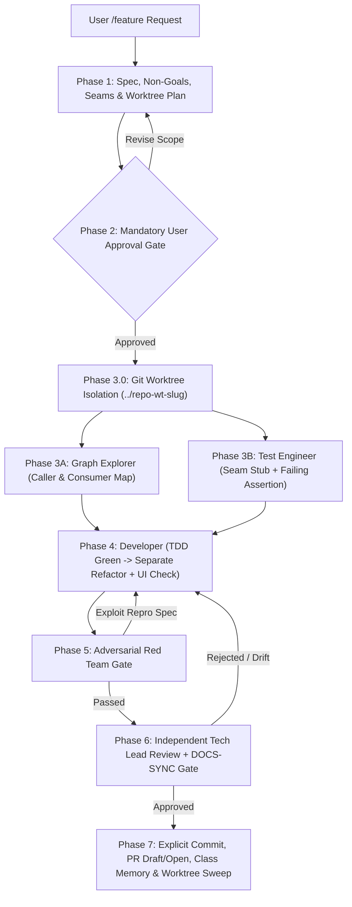

# 🚀 Feature Development Pipeline Skill

[](LICENSE)
[](https://github.com/FrancoRodriguez/feature-development-pipeline-skill)
[](https://github.com/FrancoRodriguez/feature-development-pipeline-skill/pulls)

A structured, **7-phase multi-agent software engineering pipeline** (plus companion `git-worktree` isolation skill) for agentic AI coding assistants (**Google Antigravity**, **Cursor**, **Claude Code**, **Windsurf**, **AGY CLI**).

It combines **pre-write Git worktree isolation**, **seam-driven specifications with mandatory human gates**, **parallel semantic graph exploration + assertion-first TDD**, **adversarial Red Team stress-testing**, **independent Tech Lead code review**, and **pre-commit `DOCS-SYNC` verification**.

---

## 🌟 Key Capabilities

* **🌳 Pre-Write Git Worktree Isolation (`git-worktree`)** — Cuts a dedicated `../<repo>-wt-<slug>` worktree before writing a single stub or test, bootstraps untracked stack files (`.env`, `master.key`, `node_modules`), prevents branch collisions across parallel sessions, and sweeps stale merged worktrees (> 7 days).
* **🧭 Explicit Tiered Model Routing** — Routes frontier models (`pro`) to architecture specs, adversarial Red Team, and independent code review; fast models (`flash`) to TDD/implementation loops (with 2-bounce escalation); and lightweight models (`flash_lite`) to read-only codebase graph exploration.
* **📋 Phase 1 & 2: Grill-Me Spec, Seams & Mandatory User Gate** — Defines public contract seams, `Touch` paths, and explicit Non-Goals before pausing for human approval.
* **🧪 Phase 3: Parallel Graph Exploration + Assertion-First TDD Red** — Maps downstream callers/subclasses concurrently while creating minimal seam stubs so new specs fail **on behavioral assertions**, never on missing imports or `NameError`.
* **💻 Phase 4: TDD Green, Separate Refactor & Visual UI Check** — Enforces Deep Modules, repository-only data access, separate Green vs. Refactor moves, browser visual checks for UI work, full consumer suites, and test file type-checking (`tsc --noEmit`).
* **🥊 Phase 5: Adversarial Red Team Gate** — Attacks multi-tenant isolation, race conditions, malformed inputs, N+1 queries, and 429/504 failure modes with reproducing failing specs.
* **🛡️ Phase 6: Independent Tech Lead Review & `DOCS-SYNC` Gate** — Fresh-context review verifying empirical suite execution counts (zero silent skips), `DOCS-SYNC: PASS` across `AGENTS.md` / skills / ADRs, and defect **class** recording on bugfixes.
* **🔀 Phase 7: Explicit Staging, Safe PR Handoff & Worktree Sweep** — Enforces `git add <paths>` (never `git add .`), clean commit messages without AI trailers, strict no-auto-merge guardrails, and stale worktree cleanup prompts.

---

## 🔄 Pipeline Architecture



---

## 📦 Installation

### Option 1: Google Antigravity (Global User Skills)

```bash
mkdir -p ~/.gemini/config/skills/feature-development-pipeline ~/.gemini/config/skills/git-worktree
cp SKILL.md ~/.gemini/config/skills/feature-development-pipeline/SKILL.md
cp skills/git-worktree/SKILL.md ~/.gemini/config/skills/git-worktree/SKILL.md
```

### Option 2: Repository-Local Skills (Cursor, Claude Code, Antigravity)

```bash
mkdir -p .agents/skills/workflow/feature-development-pipeline .agents/skills/tooling/git-worktree
cp SKILL.md .agents/skills/workflow/feature-development-pipeline/SKILL.md
cp skills/git-worktree/SKILL.md .agents/skills/tooling/git-worktree/SKILL.md
```

---

## 📂 Repository Contents

* [`SKILL.md`](SKILL.md) — 7-Phase Multi-Agent Feature Development Pipeline & Model Routing table.
* [`skills/git-worktree/SKILL.md`](skills/git-worktree/SKILL.md) — Companion Git Worktree lifecycle, stack bootstrap, and stale-worktree cleanup skill.
* [`LICENSE`](LICENSE) — MIT License.

---

## 📄 License

This project is licensed under the [MIT License](LICENSE).
