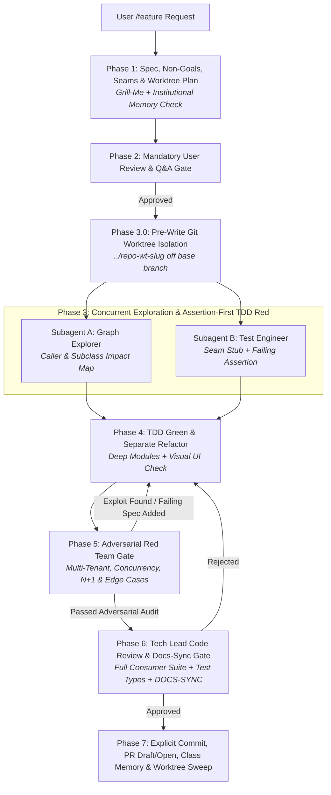

# Feature Development Pipeline Skill

A structured, 7-phase multi-agent software engineering pipeline for AI coding assistants. Every feature or bugfix progresses through explicit architectural seams, isolated git worktrees, assertion-first TDD, adversarial stress-testing, and independent pre-commit gates.

---

## Workflow Architecture



---

## Model Routing (Mandatory for Subagent Delegation)

Name the model tier explicitly on every delegated subagent call — **never rely on silent `inherit`**, which either burns frontier tokens on read-only file scans or runs architectural reviews on a lightweight model.

| Phase | Subagent Role | Tier | `invoke_subagent` `Model` | Purpose |
| :--- | :--- | :--- | :--- | :--- |
| 1 | `feature-spec-reviewer` | Frontier | `pro` | Architecture trade-offs, seam design, edge-case discovery |
| 3A | `feature-graph-explorer` | High-Volume | `flash_lite` | Read-only dependency, caller, and consumer mapping |
| 3B | `feature-test-engineer` | Workhorse / Fast | `flash` | Seam stubs and assertion-first TDD Red specs |
| 4 | `feature-developer` | Workhorse / Fast | `flash` | Minimal Green implementation and clean refactoring |
| 5 | `feature-red-team-adversary` | Frontier | `pro` | Adversarial security, concurrency, and resilience probing |
| 6 | `feature-code-reviewer` | Frontier | `pro` | Independent diff review, empirical suite check, `DOCS-SYNC` |

- **Escalation rule**: If `feature-developer` bounces back from Phase 5 or Phase 6 **twice** for the same defect, escalate the next attempt to `pro` (after confirming scope/context is clear).
- **Visual UI verification**: Any frontend/UI change MUST be visually inspected in a browser (desktop + mobile viewports) before entering Phase 6.

---

## Phase 1: Pre-Implementation, Seams & Ticket Creation
**Subagent**: `feature-spec-reviewer` · **Model**: `pro`
- **Role**: Analyzes requirements against codebase architecture, domain rules, data models, and UI standards **before any production or test code is written**.
- **Worktree & Branch Pre-Check**: Runs `git worktree list` and `git status --short` to detect active branches and propose:
  - Target branch: `feature/<slug>` (or `fix/<slug>` for bugfixes).
  - Dedicated worktree path: `../<repo>-wt-<slug>`.
- **Grill-Me Stress-Testing**: Probes ambiguities, failure modes, security/tenant boundaries, and defines an explicit **Out-of-Scope (Non-Goals)** list to prevent scope creep.
- **Seams & Touch Breakdown**: Defines public contract boundaries (service signatures, repository methods, API contracts, component props) and lists expected `Touch: [...]` files.
- **Deliverable**: Technical specification artifact (`ticket-<slug>.md`) ready for human review.

---

## Phase 2: Mandatory User Review & Q&A Gate
- Present the ticket summary, Non-Goals, public seams, proposed worktree/branch, and open questions directly to the user.
- **STOP. Do NOT enter Phase 3 until the user has answered open questions and granted explicit approval.**

---

## Phase 3: Worktree Isolation + Parallel Exploration & Assertion-First TDD Red

### Step 3.0: Pre-Write Git Worktree Isolation (Mandatory)
Follow [`skills/git-worktree/SKILL.md`](skills/git-worktree/SKILL.md) **before** creating any stub, test, or source file:
1. Unless the session is already inside a dedicated worktree/branch for this task, fetch `origin` and cut an isolated worktree beside the main checkout:
   ```bash
   git fetch origin
   git worktree add ../<repo>-wt-<slug> -b feature/<slug> origin/<base-branch>
   ```
2. Bootstrap untracked secrets and dependencies inside `<WT_PATH>` (e.g., `.env`, Rails `config/master.key`, `bundle` / `npm` / `pnpm`, test DB schema).
3. Verify isolation from a fresh shell before writing any file:
   ```bash
   git -C <WT_PATH> rev-parse --show-toplevel   # Must output <WT_PATH>, never the main checkout
   git -C <WT_PATH> branch --show-current       # Must output feature/<slug> or fix/<slug>
   ```
4. Bind `<WT_PATH>` as the mandatory working root across all subsequent subagents so the main checkout stays untouched.

### Step 3.1: Concurrent Subagents Execution

#### Subagent A: `feature-graph-explorer` · **Model**: `flash_lite`
- Maps affected modules, repositories, background workers, routes, and **all downstream callers/subclasses** of shared classes (using semantic graph tools where available, e.g., `codebase-memory-mcp`) so consumer test suites are never missed.

#### Subagent B: `feature-test-engineer` · **Model**: `flash`
- **Fail on an assertion, NEVER on a missing import or `NameError`**: First create the minimal empty seam stub (empty class/module/function with the agreed Phase 1 signature returning `nil` / `undefined` / `[]`), then write tests using project factories (no giant inline JSON fixtures).
- **One cycle per behavior**: Bugfixes begin with a spec that reproduces the exact bug.
- **Confirm RED narrowly**: Run the targeted spec file inside `<WT_PATH>` and confirm the failure message matches the expected behavioral assertion failure.

---

## Phase 4: TDD Green & Separate Refactor
**Subagent**: `feature-developer` · **Model**: `flash` (escalate to `pro` after 2 rejections)
- **Role**: Writes the minimal production logic inside `<WT_PATH>` to turn failing specs **GREEN**, then refactors structure in a **separate step** while keeping tests green.
- **Rules**:
  - **Never mix behavioral changes and refactoring in the same step**; if a refactor breaks a test, revert to green and split the move.
  - **Never delete, `skip`, or weaken a spec** to pass the suite.
  - **Deep Modules & Repository Discipline**: Keep public interfaces narrow and internal logic encapsulated. Persist and query exclusively through repositories/models (or dedicated query objects) — never leak raw SQL/JSONB fragments or ORM query chains into controllers, processors, or jobs.
  - Enforce tenant isolation (`current_tenant`, `organization_id`, etc.) on every query and mutation.
  - Visually verify UI changes (desktop + mobile) and strip all debug logs (`console.log`, `binding.pry`, `debugger`).
  - **Never treat only newly written specs as the gate**: Run the full suite for the touched module **plus every consumer/subclass** identified by Subagent A, and type-check test files in TypeScript repos (`npx tsc --noEmit` covering `test/`, since Jest/Vitest transpile without type-checking).

---

## Phase 5: Adversarial Red Team Stress-Testing Gate
**Subagent**: `feature-red-team-adversary` · **Model**: `pro`
- **Role**: Actively probes the implementation inside `<WT_PATH>` across 6 failure vectors before Code Review:
  1. **Multi-Tenant Isolation**: Cross-tenant parameter/ID tampering.
  2. **Concurrency & Race Conditions**: Double submissions, duplicate webhooks/jobs, missing DB unique constraints or locks, bulk `ON CONFLICT` chunk deduplication.
  3. **Malformed & Boundary Payloads**: `null`/`nil`, empty strings, negative values, oversized inputs, broken upstream payloads.
  4. **N+1 Queries & Memory Traps**: Missing eager-loading or unbounded batch loads.
  5. **External Timeouts & Rate Limits**: 429/504 handling, bounded retries with backoff/jitter, worker pool safety.
  6. **Idempotency & Replay Safety**: Safe re-execution after partial failure.
- **Gate**: Any confirmed flaw must be captured as a reproducing failing spec inside `<WT_PATH>` and bounced back to Phase 4.

---

## Phase 6: Independent Tech Lead Code Review & Docs-Sync Gatekeeper
**Subagent**: `feature-code-reviewer` · **Model**: `pro`
- **Role**: Fresh-context audit of the full branch diff (`git -C <WT_PATH> diff origin/<base-branch>`) — never self-reviewed by the author context:
  1. **Empirical Suite & Linter Verification**: Blocks approval until build, linters, security scanners (`rubocop`/`brakeman`, `eslint`, `tsc --noEmit` including tests), and full touched-module + consumer suites pass with **> 0 executed examples** (zero silent runner skips). Must report exact commands and pass/fail counts.
  2. **Architecture & Data-Access Check**: Rejects diffs that leak queries outside repositories, swallow errors silently, or miss tenant scoping.
  3. **Docs & Playbook Sync Gate (`DOCS-SYNC: PASS | FAIL`)**: Verifies whether `AGENTS.md`, `README.md`, `.agents/skills/`, or ADRs drifted relative to the diff. If conventions changed and docs were not updated on the same branch, emit `DOCS-SYNC: FAIL`.
  4. **Bugfix Class Rule**: If the branch fixes a bug or review defect, verify the **generalizable class of the defect** (not merely the isolated instance) is documented in the owning skill/changelog or project memory so the same class cannot recur.
- **Status Gate**:
  - **`REJECTED`** (or `DOCS-SYNC: FAIL`): Returns actionable structural remedies to Phase 4 (each logic defect begins with a failing spec).
  - **`APPROVED`** (`Verify GREEN` + `DOCS-SYNC: PASS`): Proceeds to Phase 7.

---

## Phase 7: Explicit Commit, PR Handoff, Institutional Memory & Worktree Sweep

> [!CAUTION]
> **GIT SAFETY & MERGE GUARDRAILS**:
> - **NEVER commit or push directly to `main`, `master`, or `develop`**.
> - **NEVER run `gh pr merge`, `git merge`, or enable auto-merge.**
> - Respect workspace push policies: if the user or workspace rules forbid automatic `git push` / `gh pr create`, stop after creating the local commit and PR description draft artifact; otherwise push only after explicit user confirmation and leave the PR **OPEN** for human review and CI.

1. **Verify Path, Branch & Git Identity**:
   - Confirm `<WT_PATH>` is on `feature/<slug>` or `fix/<slug>` and `git config user.email` matches the repository's intended identity (and matching `gh auth status` account if opening a PR).
2. **Rebase Check Against Fresh Base**:
   - Fetch `origin/<base-branch>`; if it moved ahead during the run, rebase `<WT_PATH>` cleanly and re-run the verification suite before committing.
3. **Stage Explicit Paths & Commit Cleanly (NEVER `git add .`)**:
   - Scratch tickets (`.scratch/`), screenshots, and symlinked `.env` files are often untracked — stage explicit file paths only:
     ```bash
     git -C <WT_PATH> add <path1> <path2> ...
     git -C <WT_PATH> status --short
     git -C <WT_PATH> commit -m "feat(<scope>): <description>"
     ```
   - Check `git -C <WT_PATH> log -1 --format=%B` and strip any CLI-injected AI `Co-Authored-By` or `Generated with` trailers on the unpushed commit.
4. **PR Description & Handoff**:
   - Generate `pr_description.md` summarizing motivation, architectural seams, verification counts, and `DOCS-SYNC: PASS` status.
5. **Persist Class-Level Lessons**:
   - Record any new architectural pattern or defect class into the project's institutional memory / owning skill.
6. **End-of-Run Stale Worktree Sweep**:
   - Run the non-intrusive check from [`skills/git-worktree/SKILL.md` §6](skills/git-worktree/SKILL.md) for worktrees **> 7 days old whose PR already merged**. Report the finished task first; only if candidates exist, list them (including uncommitted file counts) and ask confirmation before running `git worktree remove`.
