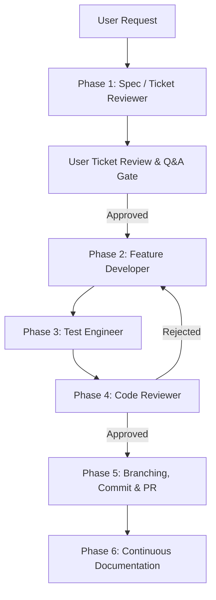

# Feature Development Pipeline Skill

A structured, 6-phase autonomous engineering pipeline for AI coding assistants. This skill enforces software engineering best practices: pre-implementation architecture specs, mandatory user approval gates, test-driven development (TDD), code review gatekeepers, automated git feature branching & PR creation, and continuous project documentation.

---

## Workflow Architecture



---

## Phase 1: Pre-Implementation & Ticket Creation
- **Role**: Analyzes user requirements against codebase architecture, domain rules, database models, and UI guidelines.
- **Deliverable**: Creates a feature specification ticket in `.scratch/ticket-[feature-name].md`.
- **Output**: Detailed specification detailing requirements, technical design, affected files, edge cases, and acceptance criteria.

> [!IMPORTANT]
> **MANDATORY USER REVIEW & Q&A GATE**:
> Immediately upon completion of Phase 1, the agent MUST present the ticket summary to the user along with any design or clarifying questions.
> **DO NOT launch Phase 2 (`feature-developer`) until the user has reviewed the ticket, answered questions, and granted explicit approval.**

---

## Phase 2: Feature Implementation
- **Role**: Implements core feature changes across UI components, API routes, and database models.
- **Rules**:
  - Adhere to project design system, modular architecture, and security guidelines.
  - Enforce tenant isolation and security scoping on database operations.
  - Clean up transient `console.log` or debug statements before concluding.
- **Deliverable**: Functional feature implementation.

---

## Phase 3: Unit Testing (TDD)
- **Role**: Writes and updates unit/integration tests (`npm test`, `pytest`, `rails test`, `go test`).
- **Rules**:
  - Mock external services and databases where required for CI reliability.
  - Cover success paths, failure states, and edge cases.
  - Execute project test suite and verify 100% of test suites pass green.
- **Deliverable**: Verified unit test suite.

---

## Phase 4: Code Review Gatekeeper
- **Role**: Mandatory quality gatekeeper auditing code quality, linting, tests, and build verification.
- **Rules**:
  - Executes project verification suite (e.g. `rubocop`, `eslint`, `brakeman`, test suite).
  - Checks for compliance with project architecture, security, and UI standards.
  - **Status Gate**:
    - **`REJECTED`**: Returns detailed list of issues to developer/tester to fix. Flow loops back to Phase 2/3.
    - **`APPROVED`**: Workflow ONLY proceeds to Phase 5 when Code Reviewer explicitly grants `APPROVED`.

---

## Phase 5: Git Identity Verification, Branching, Commit, Push & GitHub PR
- **Executed upon Code Review Approval**:

> [!CRITICAL]
> **NEVER PUSH DIRECTLY TO `main` OR `master`**. All changes MUST be committed and pushed exclusively on a new feature/fix branch (`feature/<name>` or `fix/<name>`).

> [!CAUTION]
> **STRICT NO AUTO-MERGING RULE**:
> **NEVER execute `gh pr merge`, `git merge`, or automatically merge Pull Requests.**
> The AI agent MUST ONLY create the Pull Request via `gh pr create` and leave the PR OPEN. This allows GitHub Actions CI workflows to execute and pass 100%. The user will perform code review, verify CI results, and merge the PR manually.

1. **Verify Workspace Path & User Git Identity** (MANDATORY):
   - Confirm active workspace directory.
   - Configure git user identity if required.
2. **Create New Git Branch** (Never work or push on `main`):
   ```bash
   git checkout -b feature/<feature-name>
   ```
3. **Commit Changes**:
   ```bash
   git add .
   git commit -m "feat(<scope>): <description>"
   ```
4. **Push Branch to Remote**:
   ```bash
   git push -u origin feature/<feature-name>
   ```
5. **Generate PR Description & Create PR on GitHub**:
   - Create PR description document in `pr_description.md`.
   - Execute `gh pr create` to publish the Pull Request on GitHub:
     ```bash
     gh pr create --title "feat/fix: <summary>" --body-file pr_description.md --base main
     ```

---

## Phase 6: Continuous Documentation & Memory Integrity (MANDATORY)
- **ALWAYS DOCUMENT EVERYTHING IMPLEMENTED**: Update local project documentation (e.g. `.agents/skills/`, `CODEBASE_MAP.md`, `AGENTS.md`, or relevant sitemaps/architecture guides) to record all new features, configurations, endpoints, SRE rules, and performance optimizations.
- Ensure future agent sessions and team members have complete, authoritative context on how the system is configured and built.
